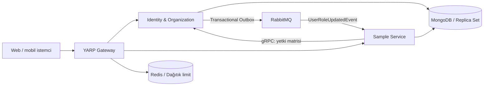

# ADNoir

[Dokümantasyon merkezi](docs/README.md) · [Servis kataloğu](docs/services/README.md) · [Yeni servis eklemek](docs/development/new-service.md)

**Çok kiracılı uygulamalar için .NET ve MongoDB tabanlı, servis odaklı bir backend altyapısı.**

[](https://github.com/alidmrky/ADNoir/actions/workflows/ci.yml)


> **Geliştirme aktif olarak devam ediyor.** ADNoir henüz kararlı bir sürüm veya üretime hazır bir ürün değildir. API'ler, yapılandırma ve servis sınırları geliştirme sürecinde değişebilir. Kodun mevcut olması, tüm dağıtık sistem senaryolarının doğrulandığı anlamına gelmez.

[Ne yapar?](#ne-yapar) · [Mimari](#mimari) · [Dokümantasyon](#dokümantasyon) · [Başlangıç](#başlangıç) · [Geliştirme rehberi](docs/development/feature-workflow.md)

[Katkı](CONTRIBUTING.md) · [Güvenlik](SECURITY.md) · [Değişiklik günlüğü](CHANGELOG.md) · [Lisans](LICENSE)

## Ne yapar?

ADNoir; birden fazla şirketin, müşterinin veya organizasyonun aynı uygulama altyapısını kullandığı sistemlerde tekrar tekrar ihtiyaç duyulan backend bileşenlerini bir araya getirir.

Kimlik yönetimi, kiracı izolasyonu, organizasyon hiyerarşisi, yetkilendirme, MongoDB veri erişimi ve servisler arası iletişim için ortak bir temel sunmayı amaçlar. Belirli bir sektöre ait hazır bir uygulama değildir; kendi iş servislerini geliştirmek için bir başlangıç altyapısıdır.

Örneğin aynı sistemde çalışan iki şirketin kullanıcıları kendi kiracılarının verilerine erişir. Bir şirketin içindeki merkez, bölge ve bayi gibi organizasyon birimleri ise ayrıca veri kapsamıyla sınırlandırılabilir.

## Öne çıkanlar

| Alan | Yaklaşım |
|---|---|
| **Çok kiracılık — multi-tenancy** | Kiracıya ait entity'lerde repository seviyesinde otomatik tenant filtresi; kontrollü kiracılar arası erişim |
| **MongoDB veri erişimi** | Repository, ortak BSON kuralları, binary GUID, optimistic concurrency ve replica set transaction desteği |
| **Organizasyon hiyerarşisi** | Ağaç yapısı, taşıma, slug değişikliği ve alt ağaç sorguları |
| **Kimlik yönetimi** | RS256 JWT, public JWKS, refresh token rotasyonu ve kullanıcı/rol yönetimi |
| **Yetkilendirme** | Rol–izin matrisi; kullanıcı, birim ve alt ağaç gibi veri kapsamları |
| **Servis iletişimi** | Yetki matrisi için gRPC; integration event'ler için MassTransit ve RabbitMQ |
| **Kritik event akışları** | İş verisi ile mesaj kaydını aynı transaction'a alan MongoDB transactional outbox |
| **API Gateway** | YARP yönlendirme, JWT pass-through, açık CORS listesi ve Redis tabanlı dağıtık istek limitleri |
| **Ortak API sözleşmesi** | `BaseResponse` zarfı, merkezi hata yönetimi ve Türkçe/İngilizce mesaj katalogları |
| **Gözlemlenebilirlik** | Serilog, OpenTelemetry, correlation/trace bilgileri ve health endpoint'leri |

**MongoDB yalnızca bağlantı kurulabilen bir seçenek değil, mevcut kalıcılık katmanının temelidir.** Domain modelleri MongoDB attribute'larına bağımlı değildir; BSON eşlemeleri Infrastructure katmanında tutulur. Mevcut uygulama MongoDB kullanır; başka veritabanları için hazır sağlayıcı iddiası yoktur.

## Mimari



Servisler `Domain → Application → Infrastructure → Api` sorumluluklarıyla düzenlenir. Domain iş kurallarını içerir; Application kullanım senaryolarını yürütür; Infrastructure veritabanı ve mesajlaşma adaptörlerini sağlar.

- **IdentityAndOrg:** Kiracı, organizasyon, kullanıcı, rol, oturum ve yetki matrisi.
- **Sample:** Yeni servisler için veri erişimi, yetkilendirme ve outbox kullanımını gösteren ince bir örnek. Gerçek bir ürün modülü değildir.
- **Gateway:** İstemci isteklerini ilgili servise ileten ortak giriş noktası.
- **Notification:** Opsiyonel SMTP e-posta servisi; tenant bazlı şablon, gönderim/deneme geçmişi ve güvenli sonuç takibi. [Kurulum ve sınırlar](docs/development/notifications.md).
- **DbMigrator:** Index oluşturma ve başlangıç verilerini hazırlama aracı.
- **Shared:** Response sözleşmeleri, domain soyutlamaları ve ortak altyapı bileşenleri.

Gateway'de JWT doğrulansa da ilgili servis kimlik, izin ve kiracı/veri kapsamı kontrollerini kendisi yapar. Gateway bu kontrollerin yerine geçmez.

## Çok kiracılık ve veri tutarlılığı

Kiracıya ait kayıtlarda filtreleme her endpoint'e ayrı ayrı bırakılmaz; repository katmanında uygulanır. Kiracı sınırını aşan sorgular özel bir arayüz ve gerekçe attribute'u ile açıkça belirtilir.

Bir kaydı güncellerken versiyon değeri de sorgu filtresine alınır. Böylece eşzamanlı iki işlemin birbirinin değişikliklerini sessizce ezmesi engellenmeye çalışılır.

Kritik bir veri değişikliği event üretiyorsa veri ve outbox kaydı aynı MongoDB transaction'ında tutulur. Mesaj broker'a daha sonra iletilir. Bu yaklaşım **en az bir kez teslim** esasına dayanır; consumer'ların yinelenen mesajları güvenle işlemesi gerekir.

Sample consumer yalnız log yazar. İş verisini değiştiren consumer’lar kalıcı bir idempotency anahtarı ve transaction sınırı tanımlamalıdır.

## Dokümantasyon

Projeyi tanımak, mevcut servisleri kullanmak veya kendi iş servisini geliştirmek isteyenler için konu bazlı rehberler **[docs klasöründe](docs/README.md)** bulunur. Rehberler projenin ne sağladığını, bileşenlerin nasıl birlikte çalıştığını ve geliştirme sırasında hangi kurallara uyulacağını açıklar.

| Aradığın bilgi | Rehber |
|---|---|
| Projenin amacı, genel akış ve mevcut sınırlar | [Proje genel anlatısı](docs/overview.md) |
| IdentityAndOrg, Gateway, Sample, Notification ve DbMigrator ne işe yarar, ne zaman kullanılır? | [Servis kataloğu](docs/services/README.md) |
| Domain, Application, Infrastructure ve API sorumlulukları; DTO ve servislerin yeri | [Katmanlar ve dosya yerleşimi](docs/architecture/layers.md) |
| Shared altındaki taban sınıflar, repository, response, context ve ortak mekanizmalar nasıl kullanılır? | [Ortak bileşen kataloğu](docs/architecture/shared-components.md) |
| DTO, arayüz, implementasyon ve validator dosyalarının düzeni | [Kod düzeni](docs/development/code-layout.md) |
| Bir özellik geliştirirken hangi adımlar izlenir? | [Geliştirme iş akışı](docs/development/feature-workflow.md) |
| Yeni servis, DI, izin, index, Gateway ve mesajlaşma bağlantıları nasıl eklenir? | [Yeni servis kontrol listesi](docs/development/new-service.md) |
| Tenant izolasyonu, canlı oturum kontrolü ve zorunlu parola değişimi | [Güvenlik akışı](docs/architecture/security.md) |
| Transaction, outbox ve tekrar teslimat nasıl ele alınır? | [Mesajlaşma ve veri tutarlılığı](docs/architecture/messaging.md) |
| Kurulum, ilk çalıştırma ve servis kimlikleri | [İlk çalıştırma](docs/development/first-run.md) · [gRPC kurulumu](docs/development/grpc-security.md) |
| Genel ve konuya özel AGENTS kuralları nerede? | [Kural haritası](docs/rules/README.md) |

**Geliştirme ilkesi:** Yeni bir altyapı bileşeni yazmadan önce Shared içindeki mevcut karşılığını kullan. Ortak response, repository, tenant veya güvenlik mekanizmasını servis içinde yeniden oluşturma; servise özel iş mantığını da ortak alana taşıma. Yeni public tipleri ayrı dosyalarda tut; DTO, arayüz ve implementasyonu birleştirme.

İlk kez inceleyenler için önerilen sıra: **genel anlatı → ilk çalıştırma → katmanlar → ortak bileşenler → ilgili servis rehberi**. Geliştirme yaparken kök [AGENTS.md](AGENTS.md) ve ilgili dizindeki kurallar birlikte geçerlidir.

Dokümantasyon proje ile birlikte güncellenir; kurulum, mimari ve geliştirme rehberlerine dokümantasyon merkezinden erişebilirsin.

## Başlangıç

### Gereksinimler

- `net9.0` hedefini derleyebilen .NET SDK ve uygulamaları çalıştırmak için .NET 9 ASP.NET Core runtime.
- Veri işlemleri için **replica set olarak çalışan MongoDB**. Geliştirmede tek düğüm yeterlidir.
- Gerçek servisler arası event teslimatı için RabbitMQ.
- Dağıtık cache/istek limitleri için Redis.

SDK başlangıç sürümü `global.json` içinde 9.0.313, ilerleme politikası `latestMajor` olarak tanımlıdır. Paket sürümleri merkezi olarak [Directory.Packages.props](Directory.Packages.props) dosyasında tutulur.

```powershell
git clone https://github.com/alidmrky/ADNoir.git
cd ADNoir
Copy-Item .env.example .env
dotnet restore AdNoir.sln
dotnet build AdNoir.sln
```

`.env` içindeki bağlantıları ortamına göre düzenle. Gerçek `.env` dosyası ve imzalama anahtarları repoya eklenmez. Production ayarları ortam değişkenlerinden sağlanır.

Servisleri başlatma, migrator, gateway ayarları ve **register → login → korumalı endpoint → refresh** örneği için [geliştirme rehberine](docs/development/gateway.md) bak.

| Bileşen | Yerel geliştirme adresi |
|---|---|
| Gateway | `http://localhost:5070` |
| Identity REST / JWKS | `http://localhost:5080` |
| Identity gRPC — HTTP/2 | `http://localhost:5082` |
| Sample API | `http://localhost:5090` |

### Docker hakkında

Docker yerel geliştirme için zorunlu değildir. MongoDB, Redis ve RabbitMQ yerel veya uzak sunucularda çalışabilir. [docker-compose.yml](docker-compose.yml), Docker bulunan makineler için altyapı tanımlarını ve isteğe bağlı `gateway` profilini içerir. Gateway profili mevcut Identity/Sample servislerine erişim ve HTTPS JWKS yapılandırması gerektirir; tüm uygulamayı tek başına başlatmaz.

**MongoDB replica set üye adresi hem container içinden hem host'tan çözülebilmelidir.** Compose'daki `mongo:27017` üyesine host üzerinden bağlanmak için host'un `hosts` dosyasına `127.0.0.1 mongo` eklenmelidir. Aksi halde port açık görünse bile replica set bağlantısı zaman aşımına uğrayabilir.

## Geliştirmeye katkı

Hata bildirimleri, kullanım senaryoları ve mimari geri bildirimler paylaşılabilir. Değişiklik hazırlamadan önce [katkı rehberini](CONTRIBUTING.md), [proje kurallarını](AGENTS.md) ve ilgili servisin kurallarını incele. Büyük değişiklikler için önce kapsamı bir issue üzerinden konuşmak, devam eden geliştirmeyle çakışmayı azaltır.

Güvenlik açığı bildirimi için issue açma; [SECURITY.md](SECURITY.md) içindeki kanalı kullan.

## Sürüm ve kararlılık

Güncel sürüm **0.1.0**. Proje `0.x` hattındadır: public yüzey kararlı değildir ve `1.0.0`'a kadar kırıcı değişiklikler herhangi bir minor sürümde gelebilir. Neyin sözleşme sayıldığı ve neyin kırıcı kabul edildiği [API değişiklik politikasındadır](docs/development/api-policy.md). Sürüm geçmişi [CHANGELOG.md](CHANGELOG.md) içindedir.

## Lisans

[MIT](LICENSE) — Copyright (c) 2026 Ali Demirkaya.
