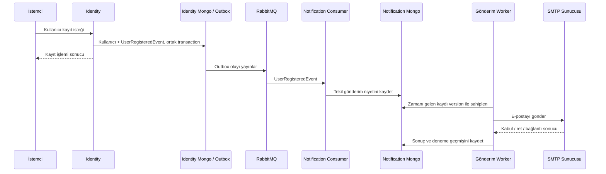

# Notification servisi nasıl çalışır?

Bu belge mevcut kodun katmanlarını ve e-posta sürecini anlatır. Kurulum ve ayar değerleri için [bildirim rehberine](../../../docs/development/notifications.md) bakabilirsin.

## 1. Notification ne işe yarıyor?

Notification, bildirim işlerini üstlenen bağımsız bir mikroservistir. Kendi içinde Domain, Application, Infrastructure ve Api projeleri bulunur. Şu an desteklediği kanal e-posta, ilk senaryo ise yeni kaydolan kullanıcıya hoş geldin e-postasıdır.

Identity servisi kullanıcı hesabını oluşturur. Notification ise bu olaydan haberdar olup hangi tenant için hangi şablonun kullanılacağını belirler, gönderilecek e-postayı kaydeder, gönderimi dener ve sonucunu tutar. Böylece kullanıcı oluşturma işlemi SMTP sunucusunun yanıtını beklemez.

Bildirim kullanımı isteğe bağlıdır. Identity'nin olay yayınlaması ve Notification'ın gönderim yapması varsayılan olarak kapalıdır. SMS, kampanya, şifre sıfırlama ve teslimat webhook'ları mevcut uygulamanın parçası değildir.

## 2. Katmanların görevleri

| Katman | Cevap verdiği soru | Mevcut örnek |
|---|---|---|
| Domain | Hangi kavramları ve durumları takip ediyoruz? | EmailDelivery, EmailAttempt, EmailDeliveryStatus |
| Application | Uygulama hangi işlemleri sunuyor, hangi sözleşmelere ihtiyaç duyuyor? | EmailQueryService, IEmailQueries, INotificationProvider, DTO'lar |
| Infrastructure | MongoDB, mesaj kuyruğu ve SMTP ile bu işlemler nasıl yapılır? | MongoEmailRepository, MongoEmailStore, UserRegisteredConsumer, EmailDispatchWorker, SmtpEmailSender |
| Api | HTTP isteği nasıl alınır, doğrulanır ve yanıtlanır? | EmailEndpoints, JWT/yetki kontrolleri, Program.cs |

Katmanlar ayrı projelerdir; hepsi ayrı çalışan uygulamalar değildir. Çalıştırılan proje AdNoir.Notification.Api'dir. Bu host API'yi, mesaj tüketicisini ve arka plan worker'ını aynı süreçte başlatır. Domain, Application ve Infrastructure bu host'un kullandığı kütüphanelerdir.

### Domain: takip ettiğimiz iş verisi

[Domain/Emails](AdNoir.Notification.Domain/Emails) altında üç temel tip bulunur:

- **EmailDelivery:** Bir e-postanın gönderim kaydıdır. Tenant, kaynak olay kimliği, şablon sürümü, alıcı/içerik, mevcut durum, zamanlar, version ve deneme listesi taşır.
- **EmailAttempt:** Tek bir gönderim denemesidir. Başlangıç/bitiş zamanı, süre, güvenli sonuç kodu ve varsa SMTP durum kodunu tutar.
- **EmailDeliveryStatus:** Pending, Processing, Accepted gibi durumları tanımlar.

Örneğin bir e-posta ilk denemede geçici hata alıp ikinci denemede kabul edilirse tek EmailDelivery ve onun altında iki EmailAttempt oluşur.

Domain MongoDB'ye bağlanmaz, SMTP kullanmaz, HTTP yanıtı üretmez. Mevcut Domain tipleri ağırlıklı olarak veri ve durum modelidir; retry ve durum geçişlerinin yürütülmesi şu anda worker/store kodundadır. Bütün gönderim kurallarının Domain metotlarında toplandığı bir model henüz uygulanmış değildir.

### Application: servis sözleşmeleri ve geçmiş sorgulama

[Application/Emails](AdNoir.Notification.Application/Emails) içindeki yapı şöyledir:

| Dosya veya klasör | Görevi |
|---|---|
| IEmailQueryService.cs | HTTP tarafının çağırdığı uygulama servisinin sözleşmesi |
| EmailQueryService.cs | Liste, detay ve istatistik işlemlerini yürütür; çağıranın tenant genelinde okuma kapsamını kontrol eder |
| Abstractions/IEmailQueries.cs | Yalnız generic repository ile ifade edilemeyen istatistik sorgulama sözleşmesi |
| Abstractions/INotificationProvider.cs | Bir gönderim kaydını sağlayıcıya iletip sonucunu alma sözleşmesi |
| Dtos/EmailDeliveryDto.cs | Dışarıya sunulacak maskelenmiş gönderim bilgisi |
| Dtos/EmailAttemptDto.cs | Dışarıya sunulacak deneme bilgisi |
| Dtos/EmailStatisticsDto.cs | Toplu analiz sonucu |
| Dtos/SendOutcome.cs | Sağlayıcı adaptöründen worker'a dönen gönderim sonucu |

EmailQueryService MongoDB sorgusu yazmaz. Liste ve detay için ortak IRepository<EmailDelivery> kullanır; istatistik için IEmailQueries çağırır. Her iki sözleşme aynı scoped MongoEmailRepository örneğine bağlanır. Liste ListLimitedAsync ile toplam saymadan ilk 100 kaydı, detay FindByIdAsync ile entity okur. DTO eşlemesi ve maskeleme Application içindeki EmailDeliveryMapping tarafından yapılır. Servis sonuçlarını BaseResponse zarfıyla döndürür. Kayıt bulunamadığında NotFound, uygun okuma kapsamı yoksa Forbidden üretir.

Burada iki farklı arayüz olmasının nedeni görev ayrımıdır: IEmailQueryService uygulamanın dış sınırıdır; IEmailQueries ise yalnız özel istatistik sorgusunun altyapı sözleşmesidir. Genel CRUD burada tekrarlanmaz.

DTO, Domain entity'sinin kendisi değildir. API'ye gerekli alanları taşır; tam alıcı, konu ve gövdeyi dışarı çıkarmaz. SendOutcome ise istemci yanıtı olmak zorunda olmayan, uygulama içindeki sağlayıcı sonuç modelidir.

**Mevcut gönderim akışı hakkında önemli ayrıntı:** Her işlem Application servisinden geçmiyor. Geçmiş okuma API → Application → Infrastructure yolunu izliyor. Olay tüketimi ve arka plan gönderimi ise Infrastructure'daki consumer/worker/store üzerinden yürütülüyor. Henüz Application içinde genel bir SendEmailService veya istemcinin istediği e-postayı gönderen bir kullanım senaryosu yok.

### Infrastructure: çalışan altyapı

[Infrastructure](AdNoir.Notification.Infrastructure) klasörleri somut entegrasyonları içerir:

| Klasör | İçindekilerin sorumluluğu |
|---|---|
| Messaging | MassTransit/RabbitMQ ayarları ve UserRegisteredConsumer |
| Persistence | Mongo sorguları, gönderim kayıtları, version kontrolü, eşlemeler, index tanımı ve index hazırlık kontrolü |
| Sending | Arka plan gönderim döngüsü ve MailKit SMTP adaptörü |
| Templates | Türkçe/İngilizce hoş geldin şablonları ve tenant şablon seçimi |
| Configuration | Genel özellik, tenant, SMTP ve şablon ayar modelleri |
| Identity | Identity servisinden gRPC ile izin bilgisi okuma ve cache entegrasyonu |
| DependencyInjection | Bu somut sınıfları arayüzlere bağlayan servis kayıtları |

UserRegisteredConsumer gelen olayı işler, ancak SMTP çağırmaz. MongoEmailStore ortak MongoRepository tabanının InsertAsync metoduyla kalıcı gönderim kaydını oluşturur. Kuyruk sorguları ortak BuildScopeFilterAsync ve SessionAccessor kullanır; sürümlü güncelleme UpdateWithScopeAsync üzerinden yapılır. Worker için açık Tenant kapsamı yalnız çözülmüş tenant içinde uygulanır. EmailDispatchWorker zamanı gelen kaydı sahiplenip INotificationProvider'ı çağırır. Bu arayüzün mevcut implementasyonu SmtpEmailSender'dır; MailKit ile SMTP sunucusuna bağlanır.

Mongo sınıf eşlemeleri Infrastructure'dadır; Domain'e BSON attribute'ları eklenmez. EmailIndexProvider index'leri tarif eder, fakat onları uygulayan araç AdNoir.DbMigrator'dır. API her açıldığında index oluşturmuyor.

### Api: dışarıya açılan HTTP sınırı ve host

[Api/Program.cs](AdNoir.Notification.Api/Program.cs) katmanların kayıtlarını birleştirir ve uygulamayı başlatır. Endpoint detaylarını içinde toplamaz.

EmailEndpoints geçmiş listeleme, tek kayıt ve istatistik uçlarını sunar. JWT doğrulanır, tenant kimliği belirlenir ve notification:read izni kontrol edilir. Application ayrıca Tenant okuma kapsamını zorunlu tutar. Başka tenant'ın kaydı kendi tenant sorgusunda bulunmaz.

API üzerinden serbest adres ve içerikle mail gönderme endpoint'i yoktur. Gönderim şu an UserRegisteredEvent ile tetiklenir. Scalar geliştirme sırasında bu okuma endpoint'lerini denemeye yarar.

## 3. Yeni kullanıcı kaydolunca adım adım ne olur?

Aşağıdaki akış için Identity yayınlama ayarı, Notification ve ilgili tenant'ın e-posta ayarı açık; RabbitMQ ve SMTP yapılandırılmış olmalıdır.



HTTP yanıtı ile arka plan olay tesliminin kesin zaman sırası garanti edilmez; kayıt isteği e-postanın gönderilmesini beklemez.

1. **Identity kullanıcıyı oluşturur.** Yayınlama açıksa UserRegisteredEvent aynı outbox transaction'ına eklenir. Kullanıcı verisi ve event için ortak session kullanılır; event yayınlama çağrısı commit'ten önce yapılır. Olay şifre veya erişim token'ı taşımaz.
2. **Outbox olayı RabbitMQ'ya taşır.** Exchange adı identity.user-registered, tüketici kuyruğu notification.user-registered olarak açıkça belirlenmiştir. Outbox burada veritabanı işlemi ile olayın kaybolmadan yayınlanması arasındaki bağı kurar.
3. **Consumer tenant'ı belirler.** Olaydaki tenant kimliğini kapsam olarak ayarlar; tenant'ın e-posta seçeneğini kontrol eder. Tenant kapalıysa Skipped kaydı oluşturur, yeni kaydın alıcı ve içeriğini saklamaz.
4. **Şablon hazırlanır.** Dil ve tenant ayarına göre şablon seçilir, displayName yerleştirilir. Şablon sürümü, konu ve gövde bu anda kayıt içine alınır. Daha sonra şablon değişse bile retry aynı içeriği kullanır.
5. **Gönderim niyeti kaydedilir.** Consumer ortak Mongo transaction'ında Pending kaydı oluşturur. Tenant + sourceEventId + kind unique index'i aynı olayın birden fazla gönderim kaydı üretmesini engeller. Eksik index ile işlem yapılmaz.
6. **Worker kaydı sahiplenir.** Version koşullu güncelleme ile kaydı Processing yapar, süreli bir sahiplik alır ve denemeyi kaydeder. Aynı kaydı aynı anda iki worker'ın sahiplenmesi engellenir.
7. **SMTP çağrısı yapılır.** Bu çağrı Mongo transaction'ı dışında yapılır. E-posta gönderimi uzun sürebilir ve dış SMTP işlemi veritabanı rollback'iyle geri alınamaz.
8. **Sonuç kaydedilir.** Worker sonuç kodunu, zamanı, süreyi ve varsa SMTP kodunu yazar. Geçici hatada tekrar zamanı belirler; kalıcı veya belirsiz sonuçta otomatik gönderimi sonlandırır.

## 4. Hata ve tekrar durumları

| Durum | Anlamı ve sonraki davranış |
|---|---|
| Pending | Gönderim sırasını bekliyor |
| Processing | Bir worker kaydı sahiplendi, deneme başladı |
| Accepted | SMTP son kabul yanıtını verdi; alıcının gelen kutusuna ulaştığı kanıtlanmış değil |
| RetryScheduled | Tekrar denenebilir sonuç; artan bekleme süresi ve küçük rastgele gecikmeyle tekrar planlandı |
| Failed | Kalıcı ret, kimlik/TLS hatası veya deneme sınırına ulaşılması |
| Skipped | Tenant için gönderim kapalı; SMTP denemesi yapılmadı |
| OutcomeUnknown | Gönderim sonucu güvenilir biçimde bilinmiyor; otomatik tekrar yok |

Örneğin SMTP e-postayı kabul ettikten hemen sonra bağlantı koparsa uygulama son yanıtı göremeyebilir. Bu durumda tekrar göndermek aynı e-postayı iki kez ulaştırabilir. Bu yüzden OutcomeUnknown kaydı tutulur; sağlayıcı kayıtlarıyla uzlaştırılması gerekir. Worker kaydı sahiplenip sonuç yazamadan kapanırsa, sahiplik süresi dolduğunda bakım işlemi yine belirsiz sonuç olarak işaretler.

Outbox ve unique index, SMTP dahil uçtan uca “kesinlikle yalnız bir e-posta” garantisi vermez. Broker tekrar teslimleri için iş düzeyinde koruma ve SMTP belirsizlikleri için ayrı davranış vardır.

## 5. Geçmiş ekranda veya API'de nasıl okunur?

```text
İstemci → Gateway → Notification API
                      → IEmailQueryService / EmailQueryService
                      → IRepository<EmailDelivery> / MongoEmailRepository (liste ve detay)
                      → IEmailQueries / MongoEmailRepository (yalnız istatistik)
                      → Tenant filtreli Mongo sorgusu
                      → Maskelenmiş DTO → BaseResponse → İstemci
```

- Liste endpoint'i en yeni en fazla 100 kaydı verir; status filtresi kullanılabilir.
- Detay endpoint'i gönderim bilgisini ve denemelerini verir.
- İstatistik endpoint'i son 30 günde oluşturulmuş kayıtların mevcut durumlarını, deneme/tekrar sayılarını ve ortalama bekleme/deneme sürelerini hesaplar.

Bu istatistik “bugün kaç e-posta teslim edildi?” anlamına gelmez. Oluşturulma tarihine göre seçilen kayıtların gönderim durumlarını gösterir. Bounce, açılma ve tıklama ölçümü henüz yoktur.

Terminal kayıtların kişisel içeriği varsayılan 30 gün sonra temizlenir. İş kimliği, durum ve deneme metadatası analiz ve tekrar olay koruması için tutulur. Temizlik için worker'ın çalışması ve tenant'ın ayarlarda bulunması gerekir. API tam konu/gövdeyi veya tam alıcı adresini döndürmez.

## 6. Dosyaları hangi sırayla okumalıyım?

1. [EmailDelivery](AdNoir.Notification.Domain/Emails/EmailDelivery.cs): ne saklıyoruz?
2. [UserRegisteredConsumer](AdNoir.Notification.Infrastructure/Messaging/UserRegisteredConsumer.cs): olaydan gönderim kaydına nasıl geçiyoruz?
3. [MongoEmailStore](AdNoir.Notification.Infrastructure/Persistence/MongoEmailStore.cs): tenant, tekrar olay ve version korumasını nasıl uyguluyoruz?
4. [EmailDispatchWorker](AdNoir.Notification.Infrastructure/Sending/EmailDispatchWorker.cs): kayıt ne zaman gönderiliyor, sonuç nasıl işleniyor?
5. [SmtpEmailSender](AdNoir.Notification.Infrastructure/Sending/SmtpEmailSender.cs): SMTP sonucu nasıl yorumlanıyor?
6. [EmailQueryService](AdNoir.Notification.Application/Emails/EmailQueryService.cs): geçmiş uygulama sınırında nasıl sunuluyor?
7. [EmailEndpoints](AdNoir.Notification.Api/Endpoints/EmailEndpoints.cs): HTTP istekleri servise nasıl bağlanıyor?
8. [Program.cs](AdNoir.Notification.Api/Program.cs): bütün bileşenler nasıl ayağa kalkıyor?

Gönderim davranışını araştırırken consumer → store → worker → SMTP sırası; geçmiş okuma davranışını araştırırken endpoint → application service → query implementasyonu sırası daha kolay takip edilir.
